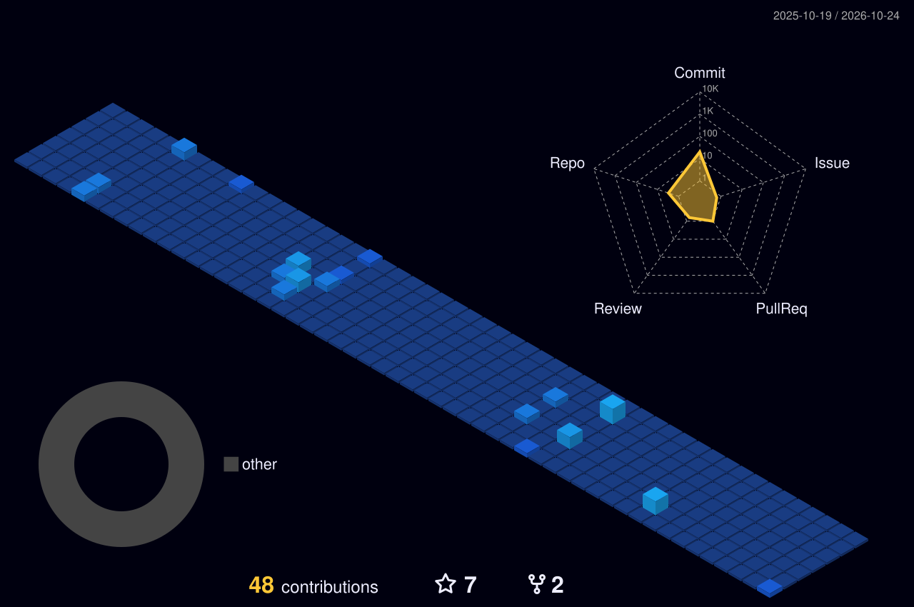

# Hi there, I'm Leslie Shumba! 👋

<div align="center">

  <!-- Dynamic Typing Header -->
  <a href="https://github.com/layan2k">
    
  </a>

  <p align="center">
    <b>Data Engineer & Infrastructure Specialist with a strong Software Engineering foundation.</b><br>
    <i>Building resilient ETL/ELT pipelines, optimizing enterprise databases, and automating scalable system infrastructure.</i>
  </p>

  <a href="https://github.com/layan2k">
    
  </a>
  &nbsp;
  

</div>

<br>

## 🚀 About Me

I am a **Data Engineer & Infrastructure Specialist** leveraging a solid **Full-Stack Software Engineering** background. Having built, deployed, and maintained production application systems, I bring a holistic understanding of how application code interacts with database engines, message queues, and cloud infrastructure.

* 🔭 **Current Focus:** Engineering fault-tolerant ETL/ELT pipelines, dimensional modeling (Star/Snowflake Schemas), and query performance tuning.
* 🛠️ **Software Engineering Foundation:** Production experience across full-stack web platforms, REST microservices, and mobile architectures using **C# / .NET**, **Java / Spring Boot**, **Python**, **Go**, and **Node.js / Next.js**.
* 🌱 **Learning Path:** Expanding into **Apache Airflow**, **PySpark**, **Data Lakehouses**, and cloud-native warehousing (**Snowflake / BigQuery**).
* ⚡ **Core Strengths:** SQL Server Integration Services (SSIS), T-SQL optimization, Dockerized data environments, and automated CI/CD deployment pipelines.
* 📫 **Reach Me:** [Email](mailto:lesliedeeshumba@gmail.com) | [LinkedIn](https://www.linkedin.com/in/leslieshumba/) | [Portfolio](https://lesliedev.netlify.app/)
* ⚡ **Fun Fact:** When I'm not tuning indexes or writing data pipelines, I am deep into **Sim-Racing** or analyzing **Aviation & Flight Mechanics**!

---

## 🛠️ Tech Stack & Ecosystem

<table>
  <tr>
    <td align="center" width="25%"><b>Data Engineering & ETL</b></td>
    <td align="left">
      
      
      
      
    </td>
  </tr>
  <tr>
    <td align="center" width="25%"><b>Databases & Storage</b></td>
    <td align="left">
      
      
      
      
      
    </td>
  </tr>
  <tr>
    <td align="center" width="25%"><b>Software Development</b></td>
    <td align="left">
      
      
      
      
      
      
      
    </td>
  </tr>
  <tr>
    <td align="center" width="25%"><b>DevOps & Infrastructure</b></td>
    <td align="left">
      
      
      
      
      
    </td>
  </tr>
</table>

---

## 🏗️ Interactive Architecture Spotlights

<details>
<summary><b>🔍 View: Enterprise Financial ETL Pipeline Architecture</b></summary>

<br>

```text
[ Frontend React/Next.js ] ──► [ REST API (Spring Boot / Express) ]
                                            │
                                            ▼  (Containerized via Docker)
                                  [ SQL / NoSQL Store ]
```

* **DevOps Pipeline:** Containerized microservices deployed via GitLab CI / Jenkins pipelines.
* **Database Access:** High-performance ORMs and raw parameterized T-SQL for low-latency queries.

</details>

<details>
<summary><b>🔍 View: Containerized Infrastructure Setup</b></summary>

<br>

* **Environment:** Hyper-V / Linux Virtualization
* **Services:** Docker Compose running isolated database engines, reverse proxies (Nginx), and CI/CD Runners.

</details>

---

## 📊 GitHub Analytics & Metrics

<div align="center">

  <!-- Streak stats (hosted by DenverCoder1 / demolab) -->
  <a href="https://github.com/layan2k">
    
  </a>

</div>

<br>

<div align="center">

  <!-- Stats + top languages, generated daily by GitHub Actions (lowlighter/metrics) -->
  

</div>

---

## 🎮 Contribution Activity

<div align="center">

  <!-- 3D contribution graph, generated daily by GitHub Actions (yoshi389111/github-profile-3d-contrib) -->
  

  <br><br>

  <!-- Contribution snake, generated daily by GitHub Actions (Platane/snk) -->
  <picture>
    <source media="(prefers-color-scheme: dark)" srcset="./dist/github-snake-dark.svg" />
    <source media="(prefers-color-scheme: light)" srcset="./dist/github-snake.svg" />
    
  </picture>

</div>

---

<div align="center">
  <sub>Designed & Engineered by <b>Leslie Shumba</b></sub>
</div>